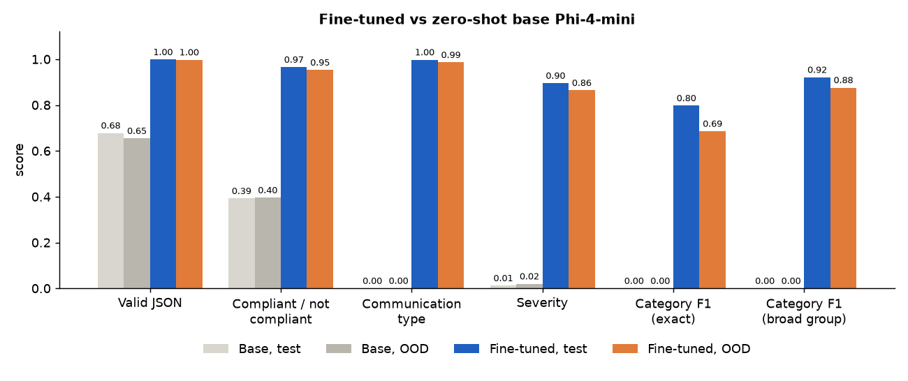
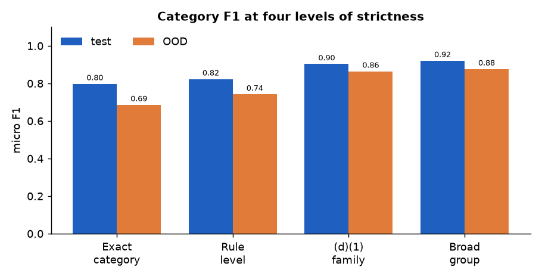
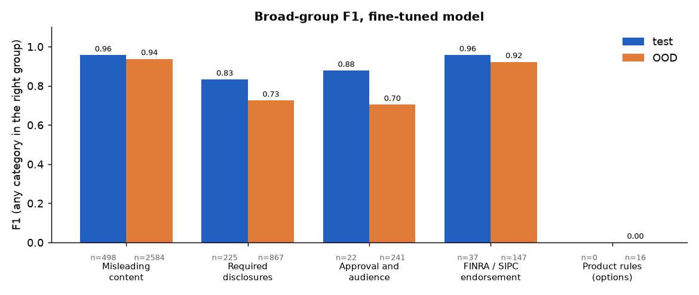
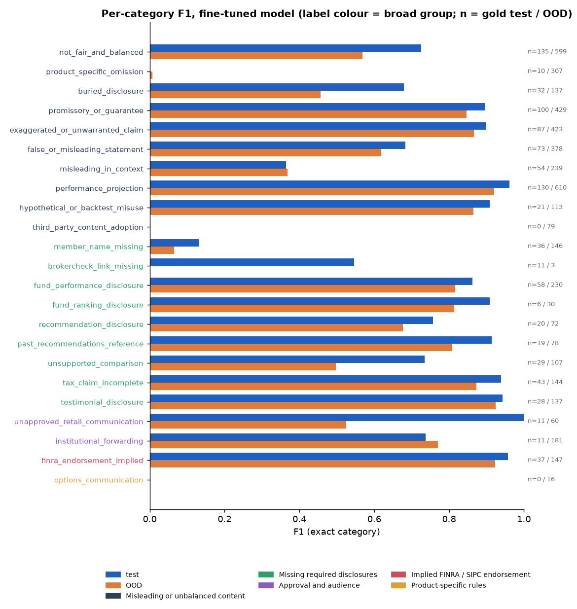
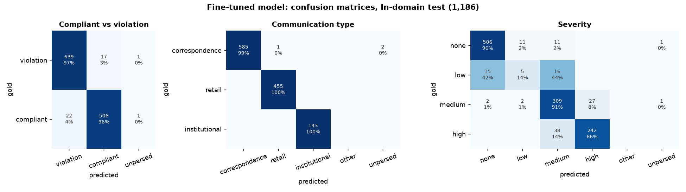
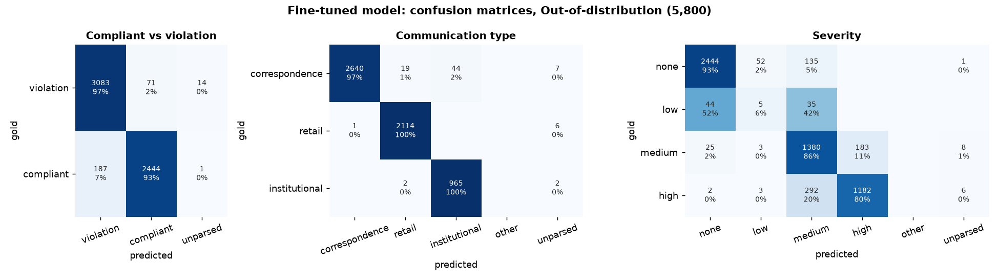
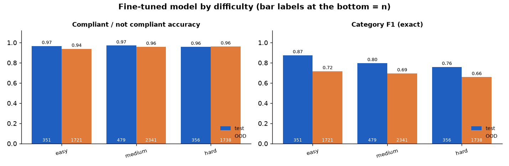
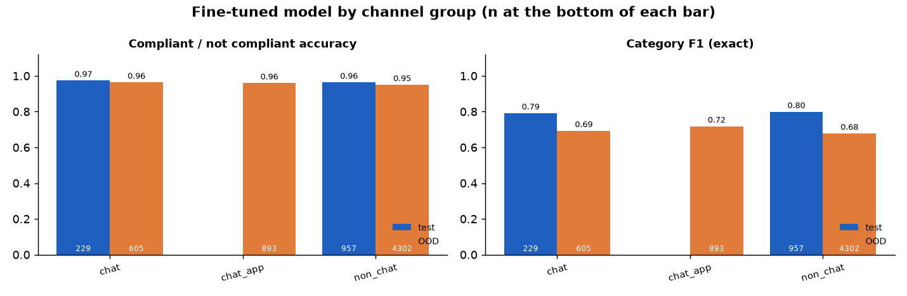
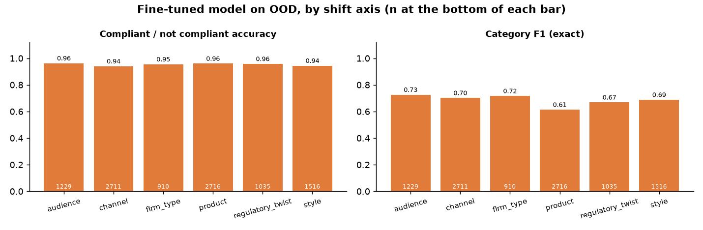
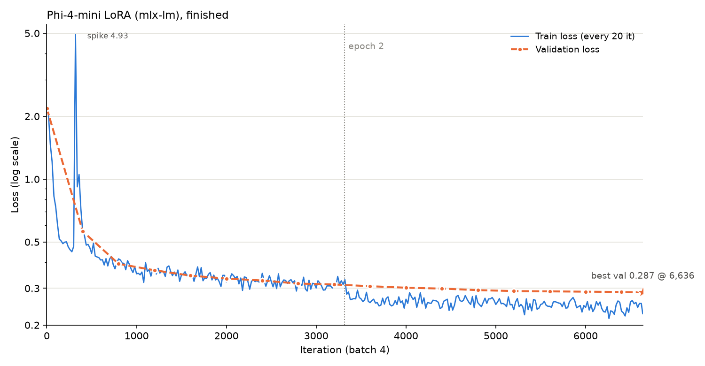

# Results — v0.1.0

Fine-tuned **Phi-4-mini-instruct + LoRA** (`runs/phi4mini-2210-mlx`, mlx-lm, 2 epochs) against the
**zero-shot base model** (`mlx-community/Phi-4-mini-instruct-4bit`, same system prompt, no examples), on the
in-domain held-out test set (1,186 items) and the out-of-distribution set (5,800 items). Generated by
[`evaluation/make_results.py`](../evaluation/make_results.py); metric definitions are in
[`evaluation/README.md`](../evaluation/README.md).

## Headline

| Metric | Base, test | Base, OOD | Fine-tuned, test | Fine-tuned, OOD |
|---|---|---|---|---|
| Valid JSON verdict | 67.8% | 65.5% | **99.8%** | **99.7%** |
| Compliant / not compliant accuracy | 39.2% | 39.6% | **96.5%** | **95.3%** |
| Communication type accuracy | 0.0% | 0.0% | **99.8%** | **98.6%** |
| Severity accuracy | 1.2% | 2.0% | **89.5%** | **86.4%** |
| Violation detection (any violation present) — F1 | 0.44 | 0.48 | **0.97** | **0.96** |
| Category, exact — F1 | 0.00 | 0.00 | **0.80** | **0.69** |
| Category, rule level — F1 | 0.00 | 0.00 | **0.82** | **0.74** |
| Category, (d)(1) family — F1 | 0.00 | 0.00 | **0.90** | **0.86** |
| Category, broad group — F1 | 0.00 | 0.00 | **0.92** | **0.88** |
| Rule cite written by the model — F1 | 0.00 | 0.00 | **0.82** | **0.74** |

**Reading the base-model column.** The zero-shot base model gets the same system prompt as the fine-tuned
model. The prompt asks for a JSON verdict with the field names, but does not list the 23 category labels or
the exact communication-type and severity values. On test the base model:
- returns a parsable verdict for 804 of 1,186 items; unparsable answers count as wrong;
- writes labels in its own words ("Retail Communication", "Moderate", invented category names), so exact-match
  type, severity and category scores are near zero. Matching the type case-insensitively gives
  31.8% on test and 30.8% on OOD; it almost never answers correspondence
  (6 of 804 parsed test answers), although half the items are correspondence;
- says compliant in 53.9% of its parsed verdicts. Its compliant / not-compliant accuracy is below the
  55.4% you would get on test by always answering "not compliant".

The comparison measures what fine-tuning taught the model, not how a carefully prompted base model would do.

## Fine-tuned model in detail

### Precision and recall

| Metric | Test P | Test R | Test F1 | OOD P | OOD R | OOD F1 |
|---|---|---|---|---|---|---|
| Violation detection (any violation present) | 0.97 | 0.97 | 0.97 | 0.94 | 0.97 | 0.96 |
| Category, exact | 0.84 | 0.76 | 0.80 | 0.70 | 0.67 | 0.69 |
| Category, rule level | 0.87 | 0.78 | 0.82 | 0.76 | 0.72 | 0.74 |
| Category, (d)(1) family | 0.94 | 0.87 | 0.90 | 0.88 | 0.85 | 0.86 |
| Category, broad group | 0.95 | 0.89 | 0.92 | 0.89 | 0.87 | 0.88 |
| Rule cite written by the model | 0.87 | 0.78 | 0.82 | 0.76 | 0.72 | 0.74 |

Most category errors are a neighbouring category inside the same rule family: F1 rises from
0.80 (exact) to 0.92 (broad group) on test and from
0.69 to 0.88 on OOD.

### Broad groups

| Broad group | Test n | Test P / R / F1 | OOD n | OOD P / R / F1 |
|---|---|---|---|---|
| Misleading or unbalanced content — 2210(d)(1) | 498 | 0.96 / 0.95 / 0.96 | 2584 | 0.92 / 0.95 / 0.94 |
| Missing required disclosures — 2210(d)(2)-(d)(8), 2212 | 225 | 0.91 / 0.76 / 0.83 | 867 | 0.78 / 0.67 / 0.73 |
| Approval and audience — 2210(a), (b) | 22 | 0.95 / 0.82 / 0.88 | 241 | 0.76 / 0.66 / 0.70 |
| Implied FINRA / SIPC endorsement — 2210(e) | 37 | 1.00 / 0.92 / 0.96 | 147 | 0.96 / 0.89 / 0.92 |
| Product-specific rules — 2220 | 0 | — | 16 | 0.00 / 0.00 / 0.00 |

### Per category

Exact-category F1 for all 23 categories (full table with hits, misses and false alarms:
[`metrics/per_category.csv`](metrics/per_category.csv)).

| Category | Test n | Test F1 | OOD n | OOD F1 |
|---|---|---|---|---|
| `not_fair_and_balanced` | 135 | 0.73 | 599 | 0.57 |
| `product_specific_omission` | 10 | 0.00 | 307 | 0.01 |
| `buried_disclosure` | 32 | 0.68 | 137 | 0.46 |
| `promissory_or_guarantee` | 100 | 0.90 | 429 | 0.85 |
| `exaggerated_or_unwarranted_claim` | 87 | 0.90 | 423 | 0.87 |
| `false_or_misleading_statement` | 73 | 0.68 | 378 | 0.62 |
| `misleading_in_context` | 54 | 0.36 | 239 | 0.37 |
| `performance_projection` | 130 | 0.96 | 610 | 0.92 |
| `hypothetical_or_backtest_misuse` | 21 | 0.91 | 113 | 0.87 |
| `third_party_content_adoption` | 0 | — | 79 | 0.00 |
| `member_name_missing` | 36 | 0.13 | 146 | 0.06 |
| `brokercheck_link_missing` | 11 | 0.55 | 3 | 0.00 |
| `fund_performance_disclosure` | 58 | 0.86 | 230 | 0.82 |
| `fund_ranking_disclosure` | 6 | 0.91 | 30 | 0.81 |
| `recommendation_disclosure` | 20 | 0.76 | 72 | 0.68 |
| `past_recommendations_reference` | 19 | 0.91 | 78 | 0.81 |
| `unsupported_comparison` | 29 | 0.73 | 107 | 0.50 |
| `tax_claim_incomplete` | 43 | 0.94 | 144 | 0.87 |
| `testimonial_disclosure` | 28 | 0.94 | 137 | 0.92 |
| `unapproved_retail_communication` | 11 | 1.00 | 60 | 0.52 |
| `institutional_forwarding` | 11 | 0.74 | 181 | 0.77 |
| `finra_endorsement_implied` | 37 | 0.96 | 147 | 0.92 |
| `options_communication` | 0 | — | 16 | 0.00 |

Most common swaps on OOD (gold category missed → category predicted instead):

- `product_specific_omission` → `not_fair_and_balanced`: 178
- `misleading_in_context` → `not_fair_and_balanced`: 62
- `misleading_in_context` → `false_or_misleading_statement`: 50
- `false_or_misleading_statement` → `not_fair_and_balanced`: 38
- `unsupported_comparison` → `not_fair_and_balanced`: 31
- `not_fair_and_balanced` → `false_or_misleading_statement`: 30

### Confusion matrices

Rows are gold labels, columns are predictions; each cell shows the count and its share of the row.

### Breakdowns

Channel groups: `chat` = SMS, instant message, text blast; `chat_app` = the OOD-only WhatsApp, LinkedIn,
X and Slack/Teams DMs; `non_chat` = everything else.

Each OOD item is shifted on 1–3 axes, so an item counts toward every axis it shifts.

| OOD shift axis | Items | Compliant / not compliant | Category F1 (exact) | Category F1 (broad group) |
|---|---|---|---|---|
| audience | 1,229 | 96.3% | 0.73 | 0.88 |
| firm_type | 910 | 95.5% | 0.72 | 0.89 |
| channel | 2,711 | 94.0% | 0.70 | 0.87 |
| style | 1,516 | 94.4% | 0.69 | 0.87 |
| regulatory_twist | 1,035 | 95.8% | 0.67 | 0.85 |
| product | 2,716 | 96.0% | 0.61 | 0.88 |

The verdict holds on every axis; product shifts cost the most on naming the category.

### Categories never seen in training

| Category (OOD only) | OOD items | Named by the model | Still flagged not compliant |
|---|---|---|---|
| `options_communication` | 16 | 0 | 16 |
| `third_party_content_adoption` | 79 | 0 | 78 |

The model never names a category it was not trained on, but it still flags almost all of these items
as not compliant, usually under a general 2210(d)(1) category such as `not_fair_and_balanced` or
`promissory_or_guarantee`.

## Training

Full summary: [`training/training_summary.md`](training/training_summary.md) (copied from `runs/phi4mini-2210-mlx`).

## Files

| Path | Contents |
|---|---|
| `metrics/fine_tuned_{test,ood}.json`, `metrics/base_zero_shot_{test,ood}.json` | full eval reports from `finra2210.evaluate` (overall and every breakdown) |
| `metrics/per_category.csv` | fine-tuned per-category gold / hits / missed / false alarms / P / R / F1, test and OOD |
| `metrics/summary.json` | headline numbers for all four runs |
| `predictions/*.preds.jsonl.gz` | every prediction (`id`, parsed `pred`, `raw` text when unparsable), for re-scoring with `evaluate.py --score-only` |
| `plots/` | the figures above |
| `training/` | loss curve, loss data and training summary of the fine-tuned run |

_Generated by `evaluation/make_results.py` from the eval runs; rerun it after a new eval._
